# gensane

A static site generator for developers who want a blog and a portfolio online in minutes, with nothing to learn but Markdown. It has
no dependencies: the Markdown compiler, the template language and everything else are written by hand, and tested hard.

<picture>
  <source media="(prefers-color-scheme: dark)" srcset="docs/images/palette-default-dark.png">
  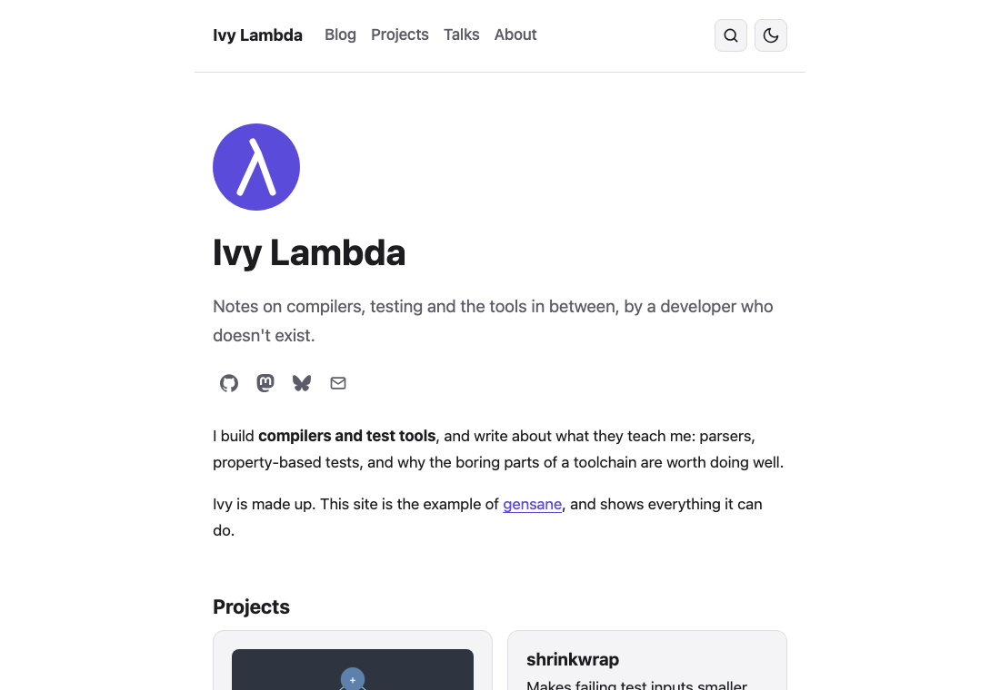
</picture>

> **Status:** the first release, 0.1. Everything below works and is tested; [issues](https://github.com/babaygt/gensane/issues)
> and ideas are welcome.

## Start

```sh
npx @gensane/cli init my-site
cd my-site
npm install
npm run dev
```

[`gensane init`](docs/cli/init.md) asks a few questions, such as the site's title and where it will be published, and writes a site
that builds at once. `npm run dev` serves it at `http://localhost:4000/` and reloads the browser when a file changes.

Then write Markdown: posts in `content/blog/`, projects, talks, experience and education in their folders, and pages in
`content/pages/`. [`gensane new post "Hello World"`](docs/cli/new.md) starts one with the fields it needs.
[Your first site](docs/start/tutorial.md) goes from an empty folder to a site online, step by step.

## What you get

- **A theme that needs no templates**, with [six palettes](docs/cli/config.md#theme), light and dark, all readable to WCAG AA: a
  home page with your name, picture and profiles, a blog as a list or as cards, projects, talks, and an about page with experience
  and education. [Any part can be replaced](docs/cli/theme.md) by one file of your own.
- **Markdown as GitHub writes it**: tables, task lists, footnotes, callouts, and [colors in code](docs/highlight/README.md) at build
  time.
- **Search** that finds as you type, with no server, and a table of contents on long posts.
- **An Atom feed, a sitemap and tags**, and [broken links that stop the build](docs/core/links.md), with the line they are on.
- **Publishing on GitHub Pages, Cloudflare or Netlify** with one file, which [`gensane deploy init`](docs/cli/deploy.md) writes.
- **Every problem printed with its file, line and column**, and a hint how to fix it. Small, fast pages: valid HTML, accessible, and
  less than 3 KB of CSS and two small scripts as readers download them.

[The example site](example/), the portfolio of a developer who doesn't exist, uses every feature.

## Six palettes

| Palette     | Light                                                                    | Dark                                                                   |
| ----------- | ------------------------------------------------------------------------ | ---------------------------------------------------------------------- |
| `default`   |      | 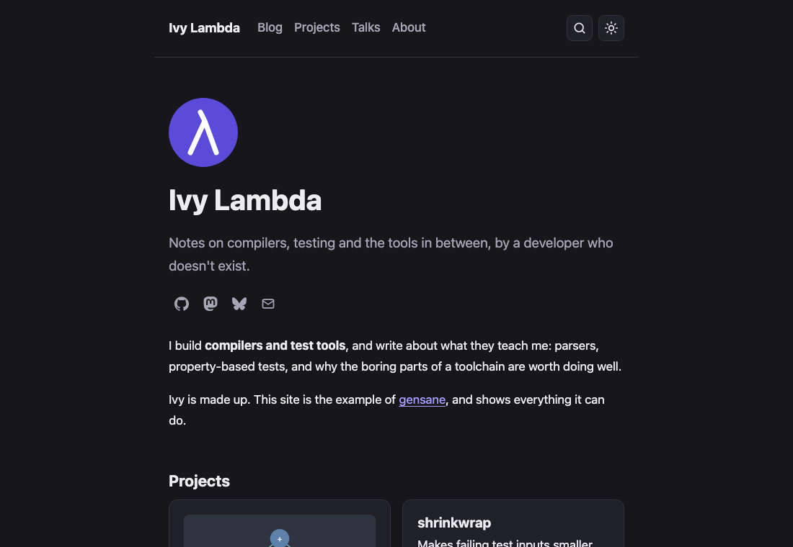     |
| `paper`     | 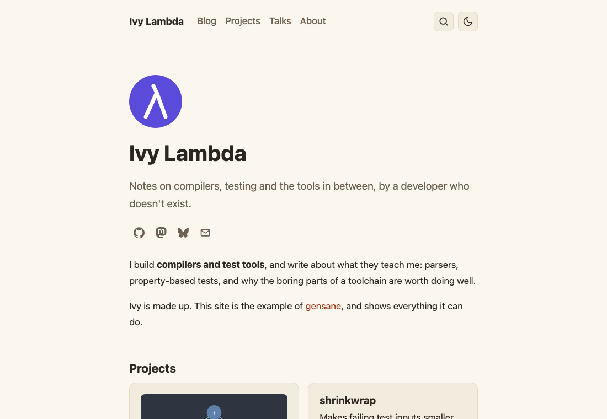         | 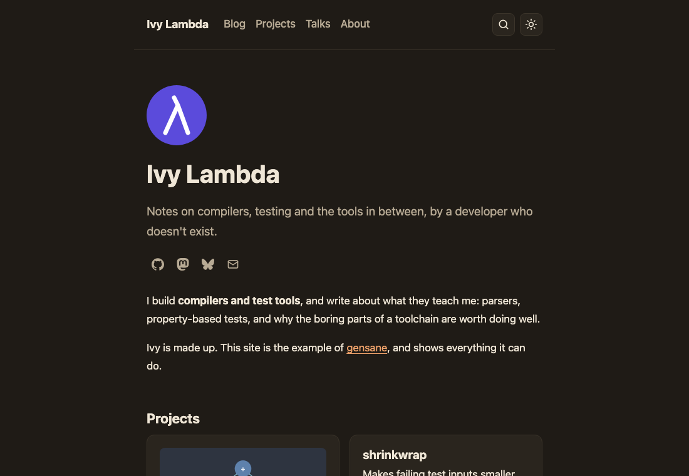         |
| `nord`      | 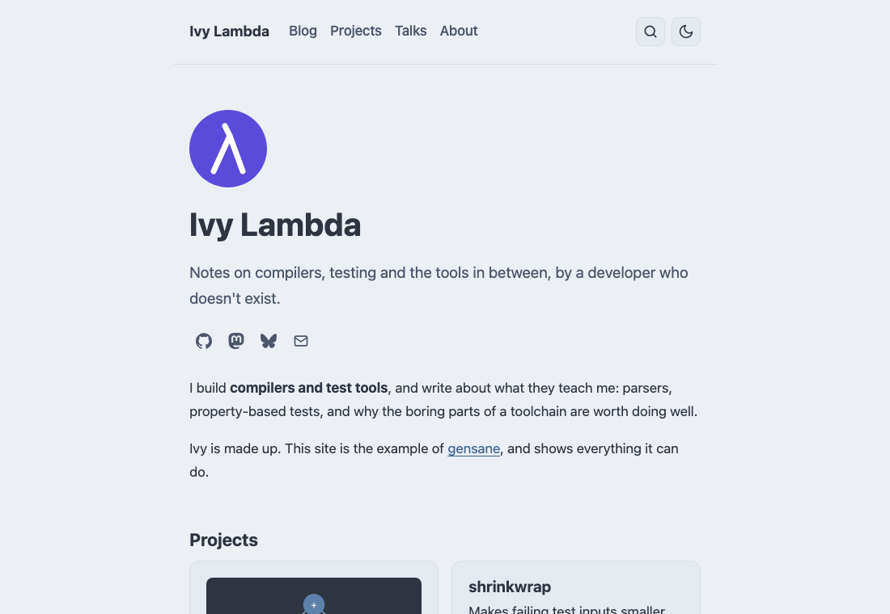           | 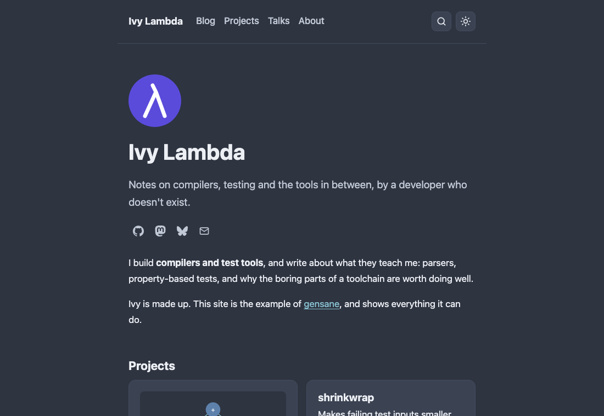           |
| `solarized` | 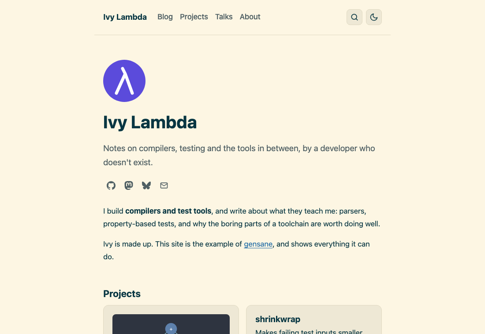 | 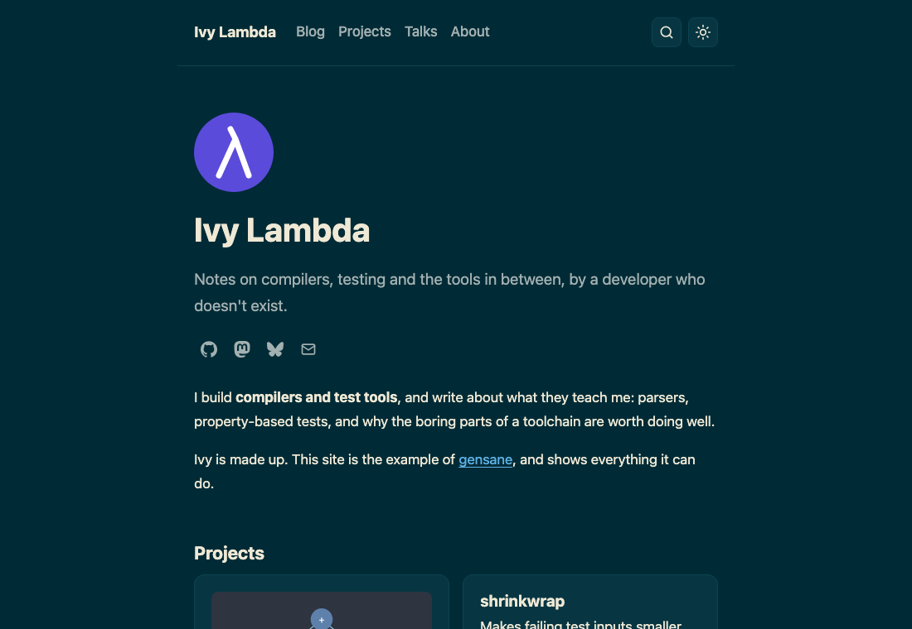 |
| `gruvbox`   | 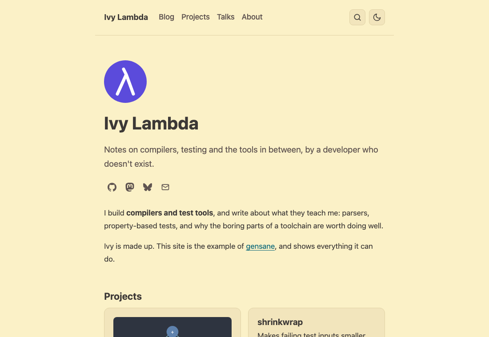     | 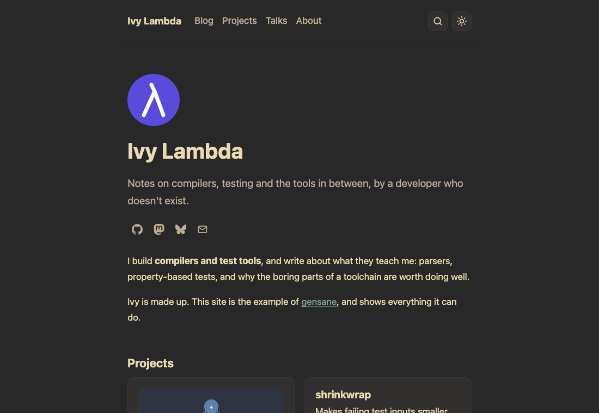     |
| `midnight`  | 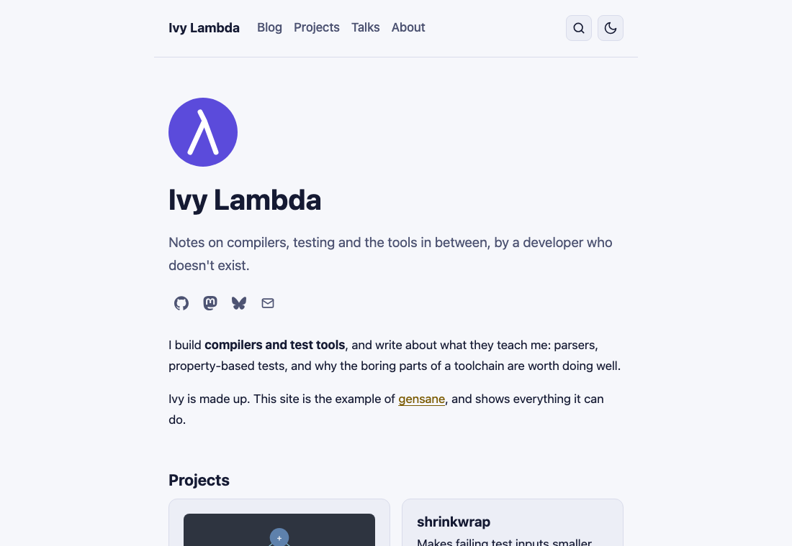   | 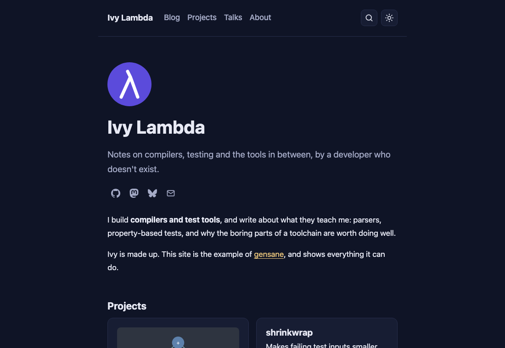   |

Readers see the side their system prefers, and can switch with the sun and moon button. Choose a palette in `gensane.config.ts`:

```ts
import { defineConfig } from "@gensane/cli";

export default defineConfig({
  site: { title: "Ada's notes", url: "https://ada.dev", author: "Ada", github: "ada" },
  theme: { palette: "nord" },
});
```

## How it is made

Every part is written by hand, each with its own documentation:

- [A Markdown compiler](docs/markdown-compiler/README.md) that passes **586 of 652** of the official CommonMark examples, with
  [every other example explained](docs/markdown-compiler/testing.md).
- [A frontmatter parser](docs/frontmatter/README.md) for a small, predictable part of YAML, and the rules of each type of content.
- [A template language](docs/template/README.md) with a lexer, a parser and an interpreter, for layouts that include and extend each
  other.
- [The core](docs/core/README.md), which turns content and templates into every page, the feed and the sitemap.
- [The command line](docs/cli/README.md): `init`, `new`, `dev`, `build`, `check`, `deploy` and `theme`.

The same files always give exactly the same site. Every example in the documentation is run by the tests, so it can't go stale.

## Contributing

[CONTRIBUTING.md](CONTRIBUTING.md) shows how to run gensane from this repository, how it is tested, and how changes are made.

## License

[MIT](LICENSE)
