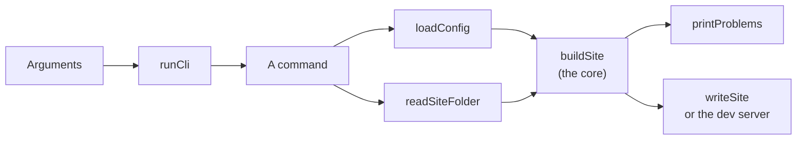
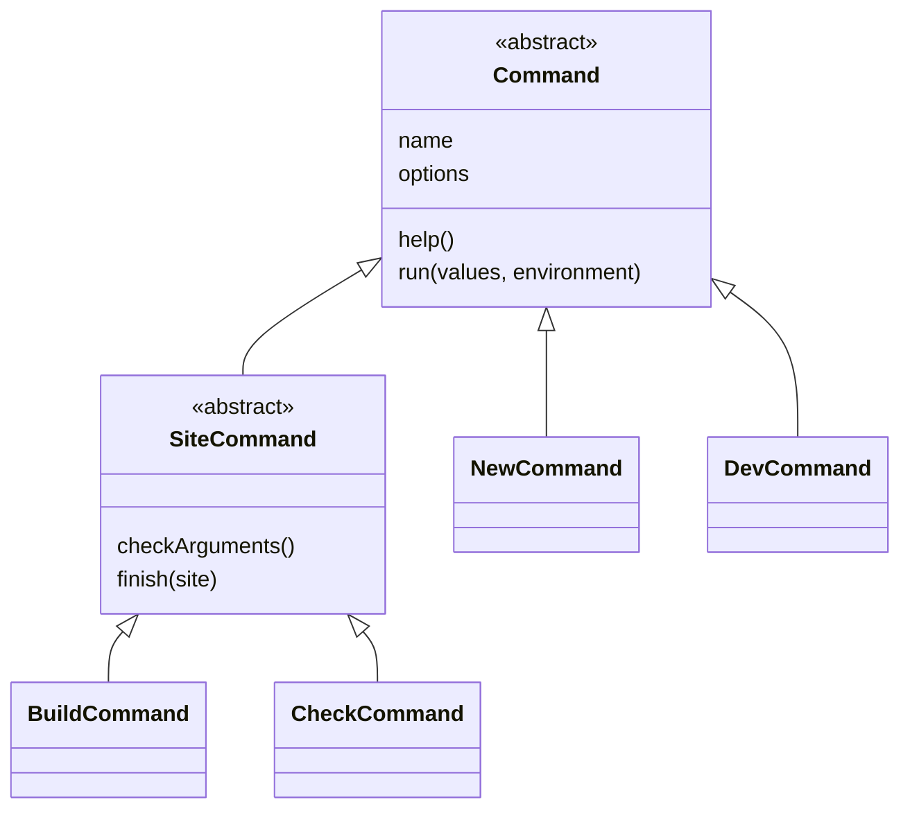

# Architecture

The [core](../core/README.md) decides what a site is, and only works on text. The command line is the thin shell around it that does
everything else: it reads the disk, runs the config, asks the clock, prints, and serves. It never decides anything about the site.

## Ports

A command never calls Node directly. Everything it needs from outside comes in one argument, the
[`Environment`](../../src/cli/environment.ts), as an interface (a port). The program passes the real versions; tests pass versions in
memory, so most tests need no disk, no clock and no network.

| Port                                              | Real version                      | Version for tests                         |
| ------------------------------------------------- | --------------------------------- | ----------------------------------------- |
| [`FileSystem`](../../src/ports/file-system.ts)    | The disk, with `node:fs`          | A disk in memory                          |
| [`ModuleLoader`](../../src/ports/module-loader.ts) | Node's `import()`                | An object that returns what a config would |
| [`Clock`](../../src/ports/clock.ts)               | The computer's clock              | A fixed time, or one that moves on        |
| [`Terminal`](../../src/ports/terminal.ts)         | The output and error streams      | One that keeps what is written            |
| [`Watcher`](../../src/ports/watcher.ts)           | `fs.watch` over the site folder   | One that tests change by hand             |
| [`Prompter`](../../src/ports/prompter.ts)         | Questions at the terminal         | One that answers from a list              |

The real disk and the disk in memory pass the same tests, so the fake can't behave differently from the real thing.

## Commands

Each command is a class. [`SiteCommand`](../../src/cli/commands/site-command.ts) holds the steps that build and check share, and each
of them only fills in what happens before and after (a template method).

## The dev server

The decisions of the server are pure functions, and [`DevServer`](../../src/cli/dev/dev-server.ts) only joins them to HTTP, the
watcher and the builds.

| Part                                                  | Decides                                                         |
| ----------------------------------------------------- | --------------------------------------------------------------- |
| [`answer`](../../src/cli/dev/answer.ts)               | What a request gets: a file, a public file, a redirect or 404   |
| [`withLiveReload`](../../src/cli/dev/live-reload.ts)  | Where the reload script goes in a page                          |
| [`problemsPage`](../../src/cli/dev/problems-page.ts)  | The page shown while the site has errors                        |
| [`changesSite`](../../src/cli/dev/dev-server.ts)      | Which changed files build again                                 |

## Design rules

**Only the shell touches the outside.** `src/cli` and `src/ports` are the only folders allowed to import Node's built-in modules, and
the [architecture test](../../test/architecture/architecture.test.ts) enforces it. `src/config` checks the config without running it.

**Problems are values.** Every mistake in a site comes back as a problem with its place, and is printed; a command never throws for
one. An exception reaching [`runCli`](../../src/cli/run-cli.ts) is the disk failing, or a bug in gensane, and is reported without a
crash.

**Nothing half done.** A build writes nothing when the site has errors, the output folder is checked before anything is read, and a
content file is never replaced.
