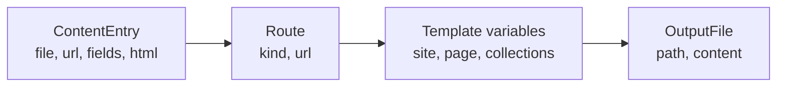

# Architecture

[`buildSite`](../../src/core/build/build-site.ts) runs five steps. Each step only runs when the steps before it found no errors, so it
never has to deal with broken input, and the warnings of every step are kept.

```mermaid
flowchart TD
    content["Content files, as text"] --> load["Read the entries<br/><code>loadContent</code>"]
    load --> graph["Work out every page<br/><code>buildSiteGraph</code>"]
    templates["Templates, as text"] --> compile["Compile the templates<br/><code>compileTemplates</code>"]
    graph --> render["Render each page<br/><code>renderTemplate</code>"]
    compile --> render
    render --> feeds["Feed and sitemap<br/><code>feedFiles</code>"]
    feeds --> links["Check links<br/><code>checkLinks</code>"]
    links --> files["Files to write"]
    load -. "problems" .-> report["Diagnostics"]
    graph -. "problems" .-> report
    compile -. "problems" .-> report
    render -. "problems" .-> report
    feeds -. "problems" .-> report
    links -. "problems" .-> report
```

The core uses the other modules through their public entry points: [frontmatter](../frontmatter/README.md) and the
[Markdown compiler](../markdown-compiler/README.md) to read entries, and the [template language](../template/README.md) to render pages.

## Folders

| Path                                                       | Responsibility                                                   |
| ---------------------------------------------------------- | ---------------------------------------------------------------- |
| [`src/core/index.ts`](../../src/core/index.ts)             | The only entry point                                             |
| [`src/core/content/`](../../src/core/content)              | Content files to entries: types, slugs, URLs, excerpts           |
| [`src/core/site/`](../../src/core/site)                    | Entries to routes: lists, orders, tags, pagination               |
| [`src/core/build/`](../../src/core/build)                  | Routes to files: `buildSite` and the variables of templates      |
| [`src/core/feeds/`](../../src/core/feeds)                  | The feed and the sitemap                                         |
| [`src/core/links/`](../../src/core/links)                  | Checking links and images                                        |

## The data

An entry is a [discriminated union](../../src/core/content/entries.ts) on its `type`, so the type of content decides which `fields` it
has: a post has a `date`, a talk has an `event`. A route is a [discriminated union](../../src/core/site/routes.ts) on its `kind`, so a
`post` route has `previous` and `next`, and a `blog` route has `pagination`.



## Design rules

**The core only works on data.** `src/core` is not allowed to import Node's built-in modules, and an
[architecture test](../../test/architecture/architecture.test.ts) enforces that. The content, the templates and the list of public files
go in as text, so the program that reads the disk decides where they come from, and tests need no files.

**The same input gives the same output.** Files are read in the order of their paths, every list has an order that ends with something
unique, and the output is sorted by path. There is no clock: a date in the future doesn't hide a post. A property test shuffles the input
and checks that the output stays identical.

**Mistakes are values, not exceptions.** Every step returns a [`Result`](../../src/diagnostics/result.ts) with every problem it found,
so one build reports everything wrong in every file, sorted by file and position. Exceptions are only for bugs in Gensane itself.

**One mistake, one problem.** A template that makes the same mistake on a hundred pages is reported once, and a missing template is
reported once, with the first page that needs it.

**Problems point at what was written.** A problem in the body of a post points at its line in the file, below the frontmatter, and a
broken link points at the place it is written, in the content or in a template.
