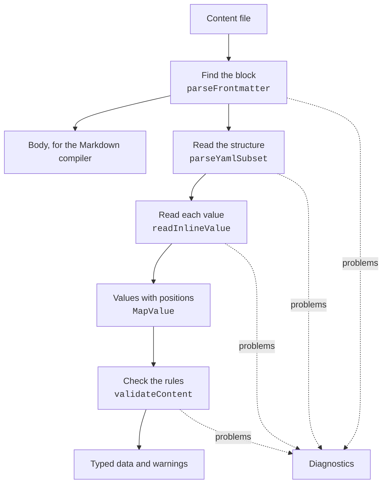
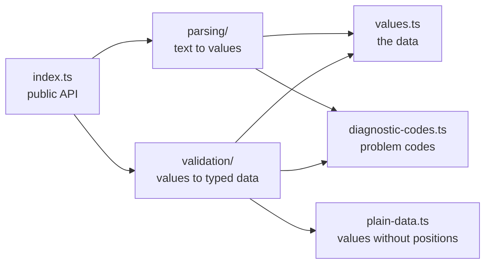
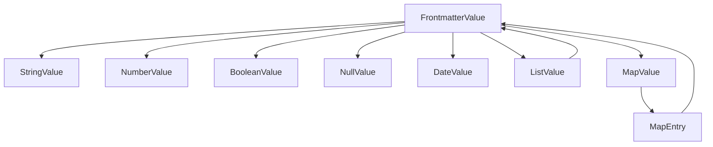

# Architecture

Frontmatter goes through two stages. Parsing decides what the text _says_, and validation decides whether that is what this type of content
_needs_. Each stage takes data, returns new data, and never reads files.

Validation only runs on a file that parsed without errors, so its rules never have to deal with half-read data.

## Folders

| Path                                                                  | Responsibility                                         |
| --------------------------------------------------------------------- | ------------------------------------------------------ |
| [`src/frontmatter/index.ts`](../../src/frontmatter/index.ts)          | Finds the block, and is the only entry point           |
| [`src/frontmatter/parsing/`](../../src/frontmatter/parsing)           | Turns lines of text into values                        |
| [`src/frontmatter/validation/`](../../src/frontmatter/validation)     | Schemas, and the rules for each type of content        |
| [`src/frontmatter/values.ts`](../../src/frontmatter/values.ts)        | The data that the two stages share                     |

## The data

Parsing produces one recursive type, [`FrontmatterValue`](../../src/frontmatter/values.ts). A list holds values and a map holds entries with
values, so settings can nest.

It is a _discriminated union_: every value has a `kind` field. Code that handles values switches on `kind` and ends with
[`assertNever`](../../src/diagnostics/diagnostic.ts), so adding a new kind of value is a compile error until every stage handles it.

## Design rules

**Stages are pure.** Frontmatter gets text and returns data. `src/frontmatter` is not allowed to import Node's built-in modules, and an
[architecture test](../../test/architecture/architecture.test.ts) enforces that.

**Every value knows where it came from.** Each value has a `span` with the file, line, column and offset of its start and end, and each map
entry also has the position of its key. Validation runs long after the text is gone, and can still point at the exact character.

**Mistakes are values, not exceptions.** Both stages return a [`Result`](../../src/diagnostics/result.ts), and a problem is a
[`Diagnostic`](../../src/diagnostics/diagnostic.ts). Neither stage stops at the first problem, so one run reports everything wrong in a file.

**State stays private.** The two parsers keep a cursor that changes as they read, but it lives in `#private` class fields. From the outside,
[`parseYamlSubset`](../../src/frontmatter/parsing/yaml-parser.ts) and
[`readInlineValue`](../../src/frontmatter/parsing/inline-values.ts) behave like pure functions.

**Types come from the rules.** The type of validated data is [inferred from its schema](validation.md), so the two can't disagree.

**Hostile input can't crash it.** Reading nested values is recursive, so nesting is limited to protect the call stack:

| Limit                 | Value     | Past the limit |
| --------------------- | --------- | -------------- |
| Nested maps and lists | 64 levels | Error GS211    |
