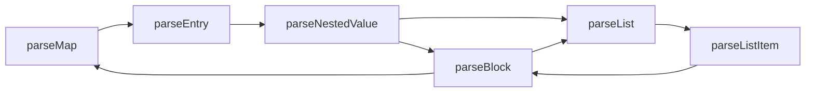

# Parsing

Parsing turns the text at the top of a file into [values](architecture.md). It has three steps, and each one works on a smaller piece
of text than the one before.

| Step               | Function                                                            | Works on            | Decides                             |
| ------------------ | ------------------------------------------------------------------- | ------------------- | ----------------------------------- |
| Find the block     | [`parseFrontmatter`](../../src/frontmatter/index.ts)                | The whole file      | Where the settings end              |
| Read the structure | [`parseYamlSubset`](../../src/frontmatter/parsing/yaml-parser.ts)   | Lines               | Which keys, lists and nesting exist |
| Read each value    | [`readInlineValue`](../../src/frontmatter/parsing/inline-values.ts) | Part of one line    | What a single value is              |

## The grammar

This is the language that the parser accepts. Indentation can't be expressed in the grammar itself, so the rules for it are in the notes on the
right.

```text
file         = [ fence, map, fence ], body
fence        = "---", spaces, line end

map          = { entry }                       every entry at the same indentation
entry        = key, ":", [ inline-value | nested ]
nested       = map | list                      deeper than the key; a list may stay level with it

list         = item, { item }                  every dash at the same indentation
item         = "-", [ inline-value | map | list ]

inline-value = double-quoted | single-quoted | flow-list | plain
flow-list    = "[", [ inline-value, { ",", inline-value }, [ "," ] ], "]"

key          = ( letter | "_" ), { letter | digit | "_" | "-" | "." }
```

## Finding the block

[`parseFrontmatter`](../../src/frontmatter/index.ts) splits the file with
[`splitSourceLines`](../../src/frontmatter/parsing/source-lines.ts), which keeps the offset of every line. If the first line isn't a fence, the
whole file is body. Otherwise the block ends at the next fence, and the position after it becomes `bodyStart`, so warnings about the body can
use real line numbers.

## Reading the structure

[`YamlParser`](../../src/frontmatter/parsing/yaml-parser.ts) is a _recursive descent_ parser: each grammar rule is one method, and nested data
is handled by methods calling each other.



Blank lines and comments are removed first, so the parser only sees lines with content. Indentation then takes the place of brackets: a map keeps
reading while lines are at its own indentation, and a deeper line starts a nested value.

A list item can hold the first key of a map on the same line as its dash:

<!-- reads -->
```yaml
---
links:
  - name: Site
    url: /
---
```

```json
{
  "links": [{ "name": "Site", "url": "/" }]
}
```

`url` lines up with `name`, not with the dash. So [`#parseListItem`](../../src/frontmatter/parsing/yaml-parser.ts) replaces the current line with
just the text after the dash, indented by its real column. The map parser then sees two ordinary lines at the same indentation and needs no
special case.

## Reading a value

[`InlineValueReader`](../../src/frontmatter/parsing/inline-values.ts) reads one value with a cursor, character by character. The first character
decides what comes next:

| First character | Reads                                                    |
| --------------- | -------------------------------------------------------- |
| `"`             | [`#readDoubleQuoted`](../../src/frontmatter/parsing/inline-values.ts) |
| `'`             | [`#readSingleQuoted`](../../src/frontmatter/parsing/inline-values.ts) |
| `[`             | [`#readList`](../../src/frontmatter/parsing/inline-values.ts), which calls itself for nested lists |
| Anything else   | [`#readPlain`](../../src/frontmatter/parsing/inline-values.ts), unless the character starts [unsupported syntax](syntax.md) |

Plain text then goes through [`#classify`](../../src/frontmatter/parsing/inline-values.ts), which tries empty, true or false, number and date, in
that order. Whatever is left is text.

## Reporting every problem

A parser that stops at the first mistake makes people fix a file one error at a time. Both parsers carry on instead:

- A broken line is reported, and [`#skipEntry`](../../src/frontmatter/parsing/yaml-parser.ts) skips it together with everything nested under it, so
  one mistake isn't reported again for each line below it.
- Inside a line, the first problem skips the rest of that line, so each line reports at most one value error.

<!-- reports GS203 -->
```yaml
---
broken line
  nested: skipped
title: fine
tags: [a, b
---
```

```text
line 2, column 1: expected a `key: value` line
hint: keys contain only letters, digits, `_`, `-` and `.`, and are followed by a colon
```

That file reports two problems, the broken line and the unclosed list (GS207), and nothing for the nested line. Tabs are found before parsing starts, so
[`parseFrontmatter`](../../src/frontmatter/index.ts) sorts the problems into file order at the end.
