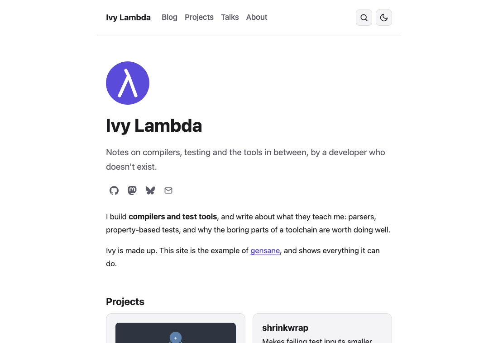
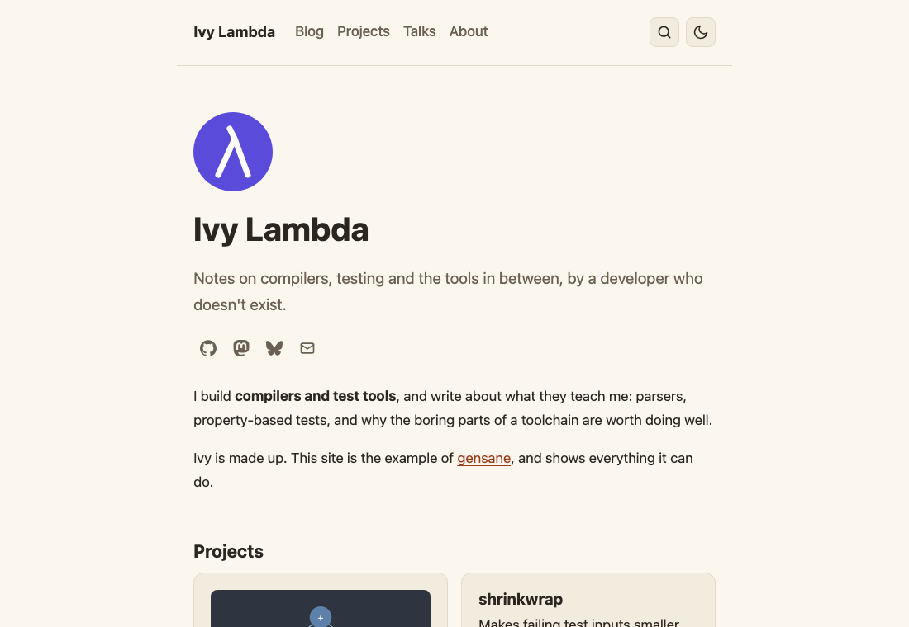
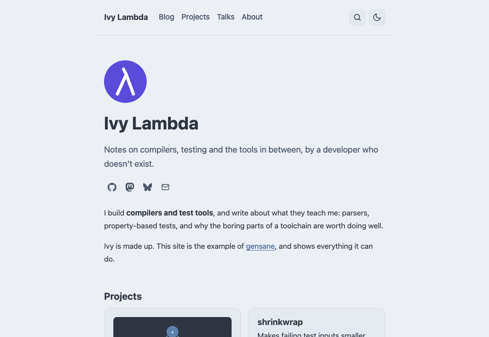
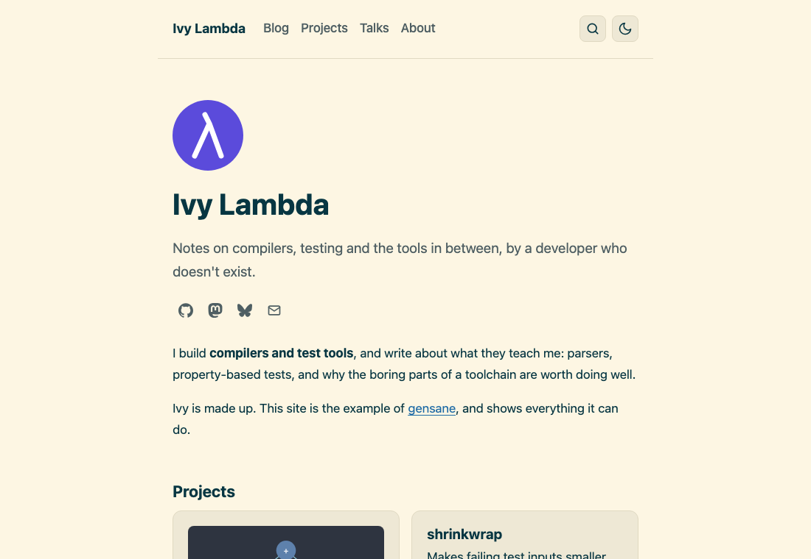
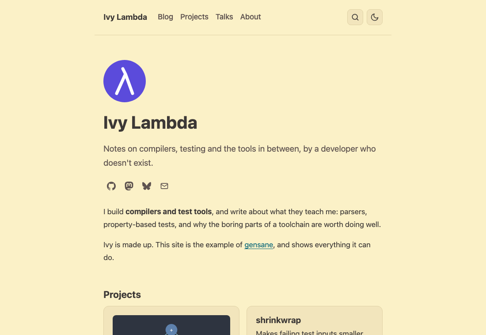
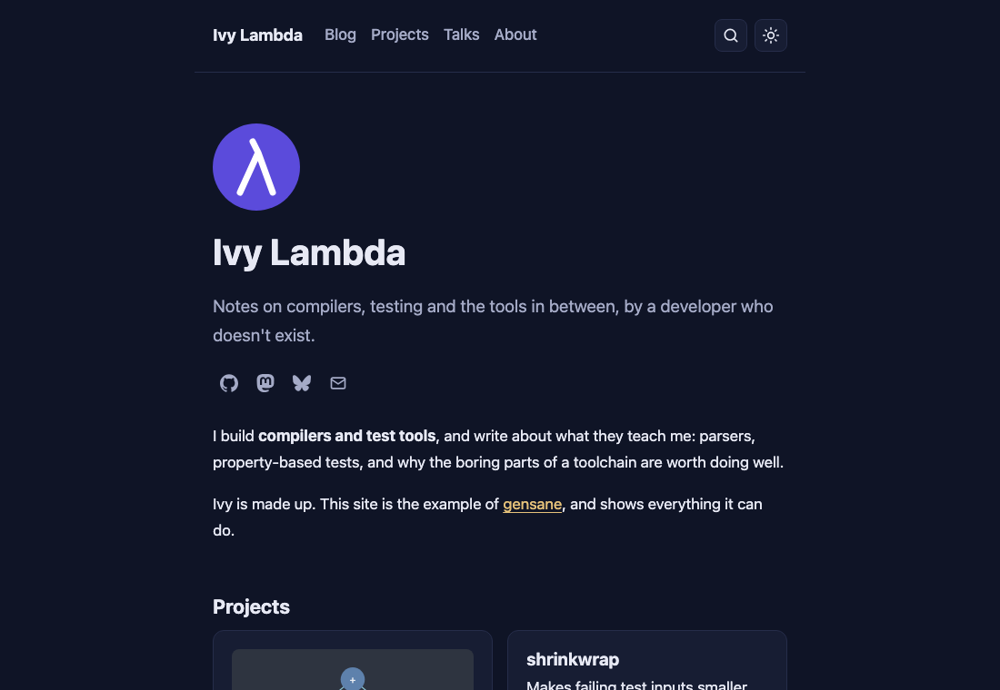

# Colors, fonts and layout

The default theme changes with a few settings under `theme` in `gensane.config.ts`. Each has a default, and none needs a template
or any CSS.

## A palette

There are six palettes, each with a light and a dark side, and every text color in them is readable on its background:

| `default`                                                   | `paper`                                                 | `nord`                                                |
| ----------------------------------------------------------- | ------------------------------------------------------- | ----------------------------------------------------- |
|  |  |  |

| `solarized`                                                     | `gruvbox`                                                   | `midnight`                                                    |
| --------------------------------------------------------------- | ----------------------------------------------------------- | ------------------------------------------------------------- |
|  |  |  |

<!-- runs -->
```ts gensane.config.ts
import { defineConfig } from "@gensane/cli";

export default defineConfig({
  site: { title: "Ada's notes", url: "https://ada.dev" },
  theme: { palette: "nord" },
});
```

```console
$ gensane check
Checked 2 pages in 9 ms, with no warnings.
```

## Light, dark, or both

By default the site follows the reader's system, and the sun and moon button in the header switches between the two sides.
`colorScheme` fixes one side instead, and the button goes away:

<!-- runs -->
```ts gensane.config.ts
import { defineConfig } from "@gensane/cli";

export default defineConfig({
  site: { title: "Ada's notes", url: "https://ada.dev" },
  theme: { palette: "paper", colorScheme: "light" },
});
```

```console
$ gensane check
Checked 2 pages in 9 ms, with no warnings.
```

## A color of your own

`accent` is the color of links and buttons, instead of the palette's. It has to be readable on both sides of the palette, and
gensane checks that it is:

<!-- runs -->
```ts gensane.config.ts
import { defineConfig } from "@gensane/cli";

export default defineConfig({
  site: { title: "Ada's notes", url: "https://ada.dev" },
  theme: { accent: "#ffd700" },
});
```

```console
$ gensane check
warning[GS507]: "theme.accent" is hard to read in the light colors of the "default" palette: 1.3 to 1, and text needs 4.5 to 1
  ┌─ gensane.config.ts
  │
  = hint: choose a darker color, or leave accent out to use the palette's own

Checked 2 pages in 9 ms, with 1 warning.
```

A darker gold passes, here with only the light side:

<!-- runs -->
```ts gensane.config.ts
import { defineConfig } from "@gensane/cli";

export default defineConfig({
  site: { title: "Ada's notes", url: "https://ada.dev" },
  theme: { accent: "#7a5f00", colorScheme: "light" },
});
```

```console
$ gensane check
Checked 2 pages in 9 ms, with no warnings.
```

## Font and width

`font` is `sans`, `serif` or `mono`, each from fonts the reader's computer already has, so nothing is downloaded. `width` is
`narrow`, `normal` or `wide`; `wide` also gives the header its own search box.

<!-- runs -->
```ts gensane.config.ts
import { defineConfig } from "@gensane/cli";

export default defineConfig({
  site: { title: "Ada's notes", url: "https://ada.dev" },
  theme: { font: "serif", width: "narrow" },
});
```

```console
$ gensane check
Checked 2 pages in 9 ms, with no warnings.
```

## The blog as cards

`blog.layout: "grid"` shows posts as cards, each with its cover picture when it has one:

<!-- runs -->
```ts gensane.config.ts
import { defineConfig } from "@gensane/cli";

export default defineConfig({
  site: { title: "Ada's notes", url: "https://ada.dev" },
  theme: { blog: { layout: "grid" } },
});
```

```markdown content/blog/2026-11-20-why-i-write-tests-first.md
---
title: Why I write tests first
date: 2026-11-20
cover: /images/tests-first.jpg
---
```

```console
$ gensane check
error[GS413]: "/images/tests-first.jpg" doesn't lead to a page or a file of the site
  ┌─ content/blog/2026-11-20-why-i-write-tests-first.md:4:8
  │
4 │ cover: /images/tests-first.jpg
  │        ^^^^^^^^^^^^^^^^^^^^^^^
  │
  = hint: check the address, or put the file in the `public` folder

Found 1 error and 0 warnings.
$ echo $?
1
```

The picture has to be there, in `public/images/`:

<!-- continues -->
```text public/images/tests-first.jpg
(the picture)
```

```console
$ gensane check
Checked 5 pages in 9 ms, with no warnings.
```

Without a `cover`, a card shows only its text.

## Contents on long posts

A post with at least three headings gets a table of contents at the top. `toc: false` leaves it out on every post.

[The config](../cli/config.md#theme) lists every setting of the theme, and [Changing one part of the theme](change-the-theme.md)
goes further than settings can.
