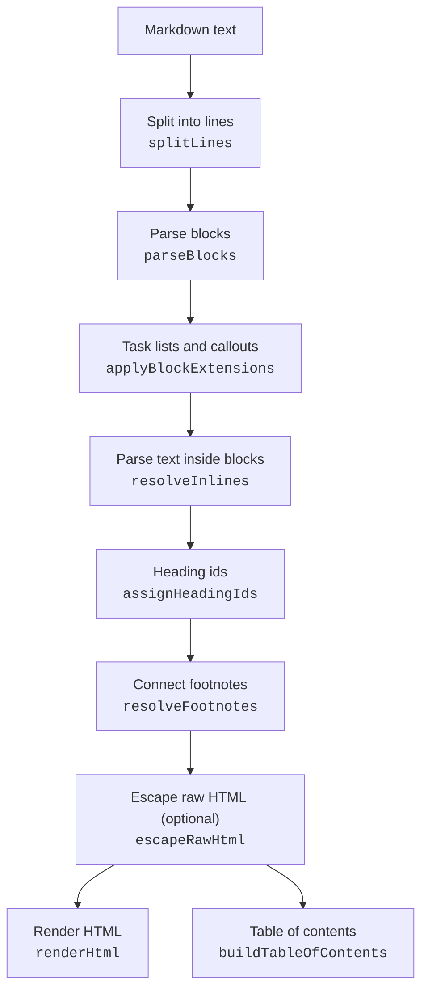
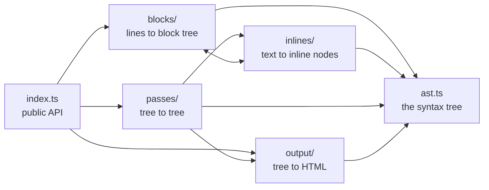
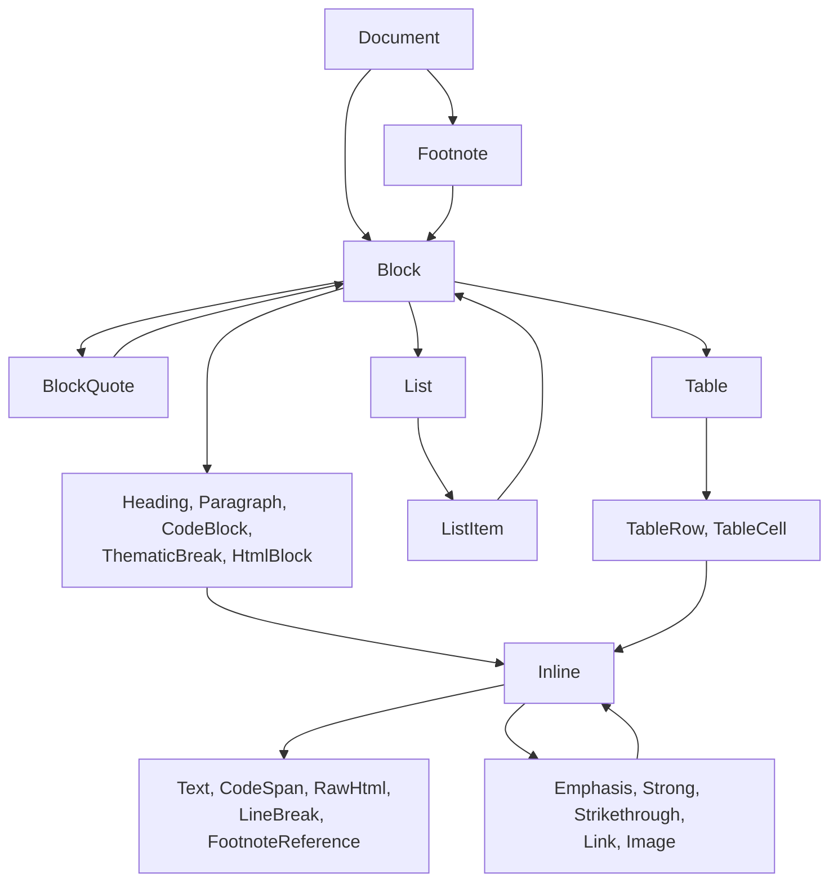

# Architecture

The compiler is a pipeline. Each stage takes data, returns new data, and never reads files or changes its
input. That makes every stage easy to test on its own.

[`parseMarkdown`](../../src/markdown/index.ts) runs every stage up to escaping, and
[`markdownToHtml`](../../src/markdown/index.ts) adds the output.

## Folders

`blocks/` and `inlines/` share two helpers: code fences use the inline code that decodes escapes, and inline HTML uses the
tag patterns from the HTML block rules.

| Folder                  | Responsibility                                                |
| ----------------------- | ------------------------------------------------------------- |
| `src/markdown/blocks/`  | Finds the structure of a document, line by line               |
| `src/markdown/inlines/` | Finds emphasis, links and other syntax inside a piece of text |
| `src/markdown/passes/`  | Steps that take a syntax tree and return a new one            |
| `src/markdown/output/`  | Turns the finished tree into HTML and a table of contents     |

## The syntax tree

All stages share one data structure, defined in [`ast.ts`](../../src/markdown/ast.ts). A document contains
blocks, and blocks with text contain inline nodes. Block quotes and list items contain blocks again, so
the type is recursive.

Both [`Block`](../../src/markdown/ast.ts) and [`Inline`](../../src/markdown/ast.ts) are _discriminated
unions_: every node has a `kind` field. Code that handles nodes switches on `kind` and ends with
[`assertNever`](../../src/diagnostics/diagnostic.ts), so adding a new kind of node is a compile error until
every stage handles it.

## Design rules

**Stages are pure.** The compiler gets text and returns data. It never touches the file system, the clock or
global state. `src/markdown` is not allowed to import Node's built-in modules, and an
[architecture test](../../test/architecture/architecture.test.ts) enforces that.

**Trees are immutable.** Nodes are `readonly`. A pass builds a new tree instead of changing the old one, so
a bug in one pass can't corrupt what an earlier pass produced.

**State stays private.** The two parsers keep a cursor that changes as they read, but it lives in `#private`
class fields. From the outside, [`parseBlocks`](../../src/markdown/blocks/block-parser.ts) and
[`parseInlines`](../../src/markdown/inlines/inline-parser.ts) behave like pure functions.

**Every node knows where it came from.** Each node has a `span` with the file, line, column and offset of its
start and end, including inside nested quotes and lists. That is what makes exact warnings possible.

**Mistakes are values, not exceptions.** User mistakes become [`Diagnostic`](../../src/diagnostics/diagnostic.ts)
values, so one run reports every problem in a file. Exceptions are only for bugs in the compiler itself
([`InternalError`](../../src/diagnostics/diagnostic.ts)).

**Hostile input can't crash it.** Recursive stages have limits, so very deep input stays safe:

| Limit                                    | Value          | Past the limit                   |
| ---------------------------------------- | -------------- | -------------------------------- |
| Nested block quotes, lists and footnotes | 256 levels     | Read as text, with warning GS105 |
| Nested emphasis and images               | 256 levels     | Stays as plain text              |
| Nested parentheses in a link destination | 32 levels      | Not a link                       |
| Length of a link label                   | 999 characters | Not a label                      |
