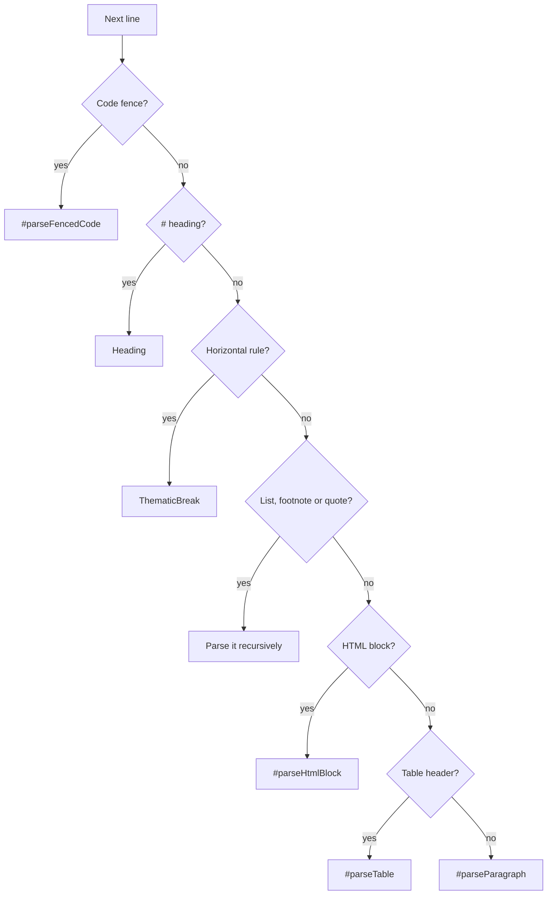
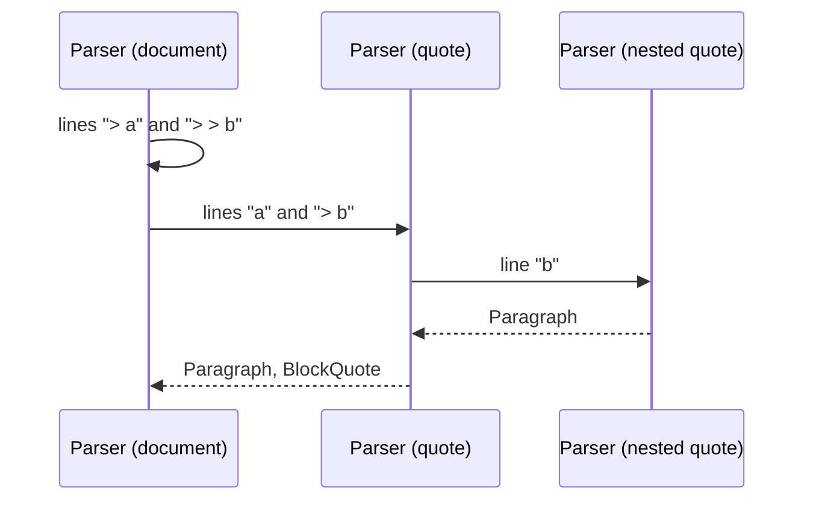

# Block parsing

Block parsing finds the structure of a document: which lines form a heading, a list or a paragraph. The text
inside those blocks stays raw until [inline parsing](inline-parsing.md).

Markdown is usually decided **line by line**, so the first stage produces lines rather than tokens.
[`splitLines`](../../src/markdown/blocks/lines.ts) keeps each line's text, line number and offsets in the
original file ([`SourceLine`](../../src/markdown/blocks/lines.ts)).

## Recognising a line

Small functions answer one question about one line, such as "is this a heading?". What one line can look like
is a _regular language_, so regular expressions are the right tool here.

| Rules                                                                    | File                                                         |
| ------------------------------------------------------------------------ | ------------------------------------------------------------ |
| Headings, horizontal rules, code fences, quotes, list markers, footnotes | [`block-rules.ts`](../../src/markdown/blocks/block-rules.ts) |
| Table rows and alignment                                                 | [`table-rules.ts`](../../src/markdown/blocks/table-rules.ts) |
| The seven kinds of HTML block                                            | [`html-rules.ts`](../../src/markdown/blocks/html-rules.ts)   |

Grouping lines needs context, which regular expressions can't hold: the same `# text` line is a heading in one
place and code inside a fence. That is the job of the parser.

## The main loop

[`#parseBlock`](../../src/markdown/blocks/block-parser.ts) looks at the next line and tries each kind of block
in a fixed order. The order matters: `* * *` is a horizontal rule, so that check comes before lists.



A paragraph continues until a blank line or a line that can interrupt it
([`interruptsParagraph`](../../src/markdown/blocks/block-parser.ts)).

## Containers are parsed recursively

Block quotes, list items and footnotes contain other blocks. The parser treats each one as a small document
inside the document:

1. Collect the lines that belong to the container.
2. Remove the `>` marker or the indentation from each line.
3. Run a new parser on those lines ([`#parseContainer`](../../src/markdown/blocks/block-parser.ts)).



Removing a marker must not lose the original position.
[`sliceLine`](../../src/markdown/blocks/lines.ts) moves a line's `start` forward but keeps `lineStart`, so a
warning inside `> > code` still reports the right column.

## Lazy lines

A paragraph in a quote may continue on a line without the `>`:

<!-- example -->
```markdown
> This quote continues
on a lazy line.
```

```html
<blockquote>
<p>This quote continues
on a lazy line.</p>
</blockquote>
```

Whether such a line belongs to the quote depends on what is inside the quote, which isn't known yet while its
lines are being collected. So the container marks the line as _lazy_ and lets the nested parser decide:

- If the line continues a paragraph, the nested parser accepts it.
- Otherwise the nested parser stops there and reports how many lines it used
  ([`LinesParseResult`](../../src/markdown/blocks/block-parser.ts)). The container ends at that line, and the
  outer parser reads it again.

Each line is therefore looked at once per nesting level, and deep nesting stays fast.

## Tight and loose lists

A list without blank lines is _tight_, and its items render without `<p>` tags. A blank line between items, or
between two blocks of one item, makes the list _loose_.

<!-- example -->
```markdown
- tight

* loose

  second paragraph
```

```html
<ul>
<li>tight</li>
</ul>
<ul>
<li>
<p>loose</p>
<p>second paragraph</p>
</li>
</ul>
```

[`hasBlankLineBetweenChildren`](../../src/markdown/blocks/block-parser.ts) detects the gap by comparing the line
numbers in the blocks' source positions.

## Tables

A table starts when a row is followed by a delimiter row such as `| --- | :-: |`, and both have the same number of
columns. [`splitTableRow`](../../src/markdown/blocks/table-rules.ts) splits a row on pipes that aren't escaped.
Short rows are filled with empty cells, and extra cells are dropped.

## HTML blocks

[`matchHtmlBlockStart`](../../src/markdown/blocks/html-rules.ts) implements the seven
[start conditions of the spec](https://spec.commonmark.org/0.31.2/#html-blocks). Kinds 1 to 5 end at a marker such
as `-->`, and kinds 6 and 7 end at a blank line. The lines are kept exactly as written.
