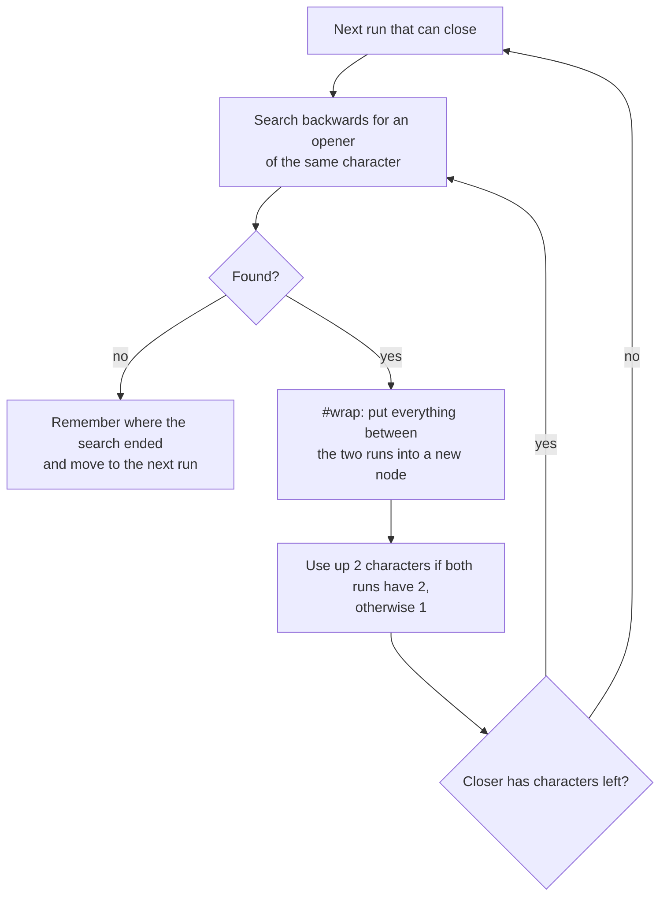

# Inline parsing

Inline parsing finds the syntax inside a piece of text: emphasis, links, code spans and more.
[`parseInlines`](../../src/markdown/inlines/inline-parser.ts) reads one character at a time, and each special
character has its own method.

| Character     | Handled by                                                                | Produces                             |
| ------------- | ------------------------------------------------------------------------- | ------------------------------------ |
| `\`           | [`#parseEscape`](../../src/markdown/inlines/inline-parser.ts)             | A literal character or a hard break  |
| `` ` ``       | [`#parseCodeSpan`](../../src/markdown/inlines/inline-parser.ts)           | `CodeSpan`                           |
| `*`, `_`, `~` | [`#parseDelimiterRun`](../../src/markdown/inlines/inline-parser.ts)       | A delimiter run, paired later        |
| `[` | [`#parseOpeningBracket`](../../src/markdown/inlines/inline-parser.ts) | A footnote reference or a bracket |
| ` | A bracket that can become an image |
| `]`           | [`#closeBracket`](../../src/markdown/inlines/inline-parser.ts)            | `Link`, `Image` or plain text        |
| `<`           | [`#parseAngleBracket`](../../src/markdown/inlines/inline-parser.ts)       | An autolink, `RawHtml` or plain text |
| `&`           | [`#parseCharacterReference`](../../src/markdown/inlines/inline-parser.ts) | The decoded character                |
| Line ending   | [`#parseLineBreak`](../../src/markdown/inlines/inline-parser.ts)          | `LineBreak`                          |

## Why emphasis needs two phases

Whether a `*` opens emphasis depends on what comes later in the text, so it can't be decided on the spot. The parser
works in two phases:

1. **Scan.** Record each run of delimiters and whether it _could_ open or close emphasis.
2. **Pair.** Walk through the runs and match closers with openers
   ([`#pairDelimiters`](../../src/markdown/inlines/inline-parser.ts)).

### Scan: can this run open or close?

The characters on either side of a run decide. A run is _left-flanking_ if it sits against the start of a word, and
_right-flanking_ if it sits against the end of one. Left-flanking runs can open, and right-flanking runs can close.

`_` is stricter than `*`: it can't open or close inside a word, which keeps `snake_case_names` as plain text.

<!-- example -->
```markdown
2 * 3 * 4, un*frigging*believable, snake_case_name
```

```html
<p>2 * 3 * 4, un<em>frigging</em>believable, snake_case_name</p>
```

### Pair: matching closers with openers



Here is how `**a *b***` is paired. The runs are `**`, `*` and `***`:

| Step | Closer | Opener | Result                                                                             |
| ---- | ------ | ------ | ---------------------------------------------------------------------------------- |
| 1    | `***`  | `*`    | The opener has one character, so this makes `<em>b</em>`. The closer has `**` left |
| 2    | `**`   | `**`   | Both have two characters, so this makes `<strong>` around everything               |

<!-- example -->
```markdown
**a *b***
```

```html
<p><strong>a <em>b</em></strong></p>
```

Two details keep this correct and fast:

- **The rule of three** ([`breaksRuleOfThree`](../../src/markdown/inlines/inline-parser.ts)). If a run can both open and
  close, the two run lengths must not add up to a multiple of 3, unless both are multiples of 3.
- **Search limits.** When a search for an opener fails, the parser remembers where it stopped, so later closers of the
  same type don't search the same runs again. This keeps long paragraphs fast.

The nodes live in a linked list ([`Entry`](../../src/markdown/inlines/inline-parser.ts)), because pairing constantly
inserts and removes nodes in the middle.

## Links and images

Every `[` or `). When a `]` appears, the
parser takes the most recent opener and tries the link forms in order
([`#linkTarget`](../../src/markdown/inlines/inline-parser.ts)):

| Form                | Example                |
| ------------------- | ---------------------- |
| Inline              | `[text](/url "title")` |
| Full reference      | `[text][label]`        |
| Collapsed reference | `[label][]`            |
| Shortcut reference  | `[label]`              |

If a link is found, emphasis inside it is paired first, so it can't reach outside the link. Links can't contain links,
so a finished link deactivates the earlier `[` openers.

<!-- example -->
```markdown
*[a*](/url) and [outer [inner](/a)](/b)
```

```html
<p>*<a href="/url">a*</a> and [outer <a href="/a">inner</a>](/b)</p>
```

The pieces of a link are read by small functions in [`link-syntax.ts`](../../src/markdown/inlines/link-syntax.ts).

## Finding the way back to the source

A paragraph's text is not a continuous slice of the file: leading spaces and quote markers have been removed from each
line. [`TextSegment`](../../src/markdown/ast.ts) records where each piece of the text came from, and
[`#sourcePosition`](../../src/markdown/inlines/inline-parser.ts) uses a binary search to turn an index in the text into a
line and column in the original file.
