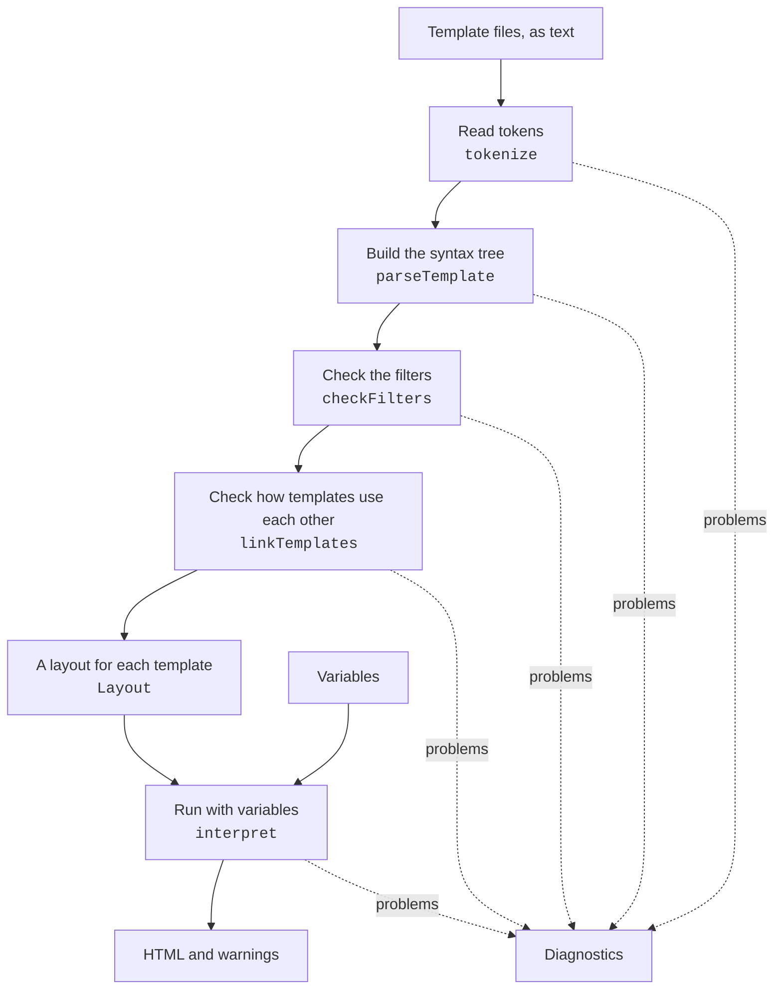
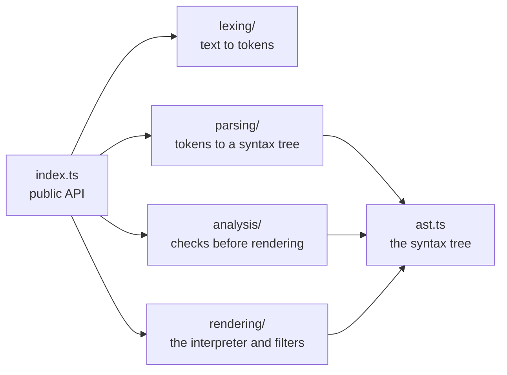
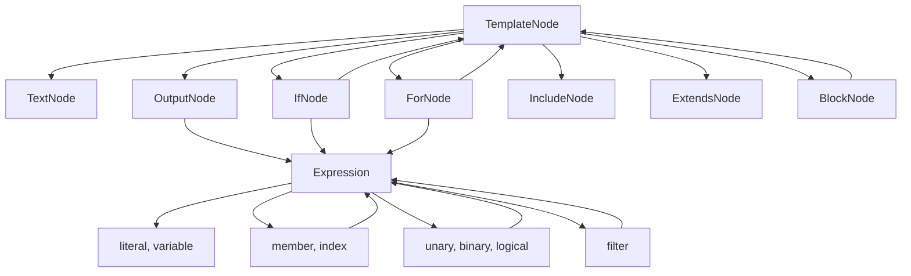

# Architecture

The template language is a small interpreter. Compiling reads each template and checks everything that doesn't need data. Rendering
then runs a compiled template with variables, as often as needed. Every stage takes data, returns new data, and never reads files.

The first three stages run on each file. Checking how templates use each other needs all of them, and only runs when every file reads
without mistakes, so its rules never have to deal with a broken syntax tree.

## Folders

| Path                                                               | Responsibility                                               |
| ------------------------------------------------------------------ | ------------------------------------------------------------ |
| [`src/template/index.ts`](../../src/template/index.ts)             | Compiles and renders, and is the only entry point            |
| [`src/template/lexing/`](../../src/template/lexing)                | Turns text into tokens                                       |
| [`src/template/parsing/`](../../src/template/parsing)              | Turns tokens into a syntax tree                              |
| [`src/template/analysis/`](../../src/template/analysis)            | Checks filters, and how templates use each other             |
| [`src/template/rendering/`](../../src/template/rendering)          | The interpreter, the values it works with, and the filters   |
| [`src/template/ast.ts`](../../src/template/ast.ts)                 | The syntax tree that the stages share                        |

## The data

The parser produces two recursive types in [`ast.ts`](../../src/template/ast.ts). A node is a piece of the template, and an expression is
a calculation inside `{{ }}` or a tag. Blocks hold nodes, so tags can nest.

Both are _discriminated unions_: every node has a `kind` field. Code that handles them switches on `kind` and ends with
[`assertNever`](../../src/diagnostics/diagnostic.ts), so a new kind of node is a compile error until every stage handles it.

## Design rules

**Stages are pure.** `src/template` is not allowed to import Node's built-in modules, and an
[architecture test](../../test/architecture/architecture.test.ts) enforces that. Templates arrive as text, so the program that reads the
files decides where they come from.

**Compile once, render many times.** Everything that doesn't depend on data is checked when compiling: syntax, filter names and arguments,
and how templates use each other. A mistake is found even in a part of a template that this page wouldn't show.

**Everything knows where it came from.** Every token and node has a `span` with the file, line, column and offset of its start and end.
Rendering happens long after reading, and can still point at the exact character.

**Mistakes are values, not exceptions.** Every stage collects problems and keeps going, and compiling and rendering return a
[`Result`](../../src/diagnostics/result.ts), so one run reports everything wrong. Exceptions are only for bugs in Gensane itself.

**One mistake, one problem.** A value that failed spreads through the expression around it without new problems, a broken tag keeps its
block open so the end tag still matches, and a mistake inside a loop is reported once, not once for each item.

**State stays private.** The lexer, the parser, the linker and the interpreter each keep state in `#private` class fields. From the
outside, each one behaves like a pure function.

**Safe by default.** Output is escaped unless a template asks for `raw`, a template can only read the fields of the data itself, and
filters are the only functions a template can call.

**Hostile input can't crash it.** Reading and running nested code is recursive, so nesting is limited to protect the call stack:

| Limit                   | Value      | Past the limit |
| ----------------------- | ---------- | -------------- |
| Nested expressions      | 64 levels  | Error GS313    |
| Parts of one expression | 1000 parts | Error GS314    |
| Nested blocks           | 64 levels  | Error GS313    |
| Included templates      | 32 levels  | Error GS313    |

A long chain such as `a + a + a` has no brackets, but still builds a deep tree, which is why the length of one expression is limited too.
Templates can't include each other in a circle, which is found with a search that keeps its own stack, so even thousands of templates in
a chain can't overflow it.
