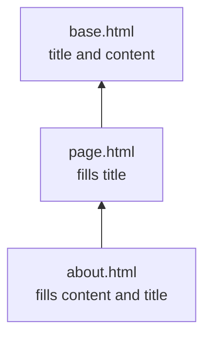

# Layouts

A theme is several templates that use each other: a base layout, pages that build on it, and small parts such as the navigation. A
template is named by its path, such as `partials/nav.html`, and names are always written in quotes, so every link between templates is
checked before anything is rendered.

## Including a template

`` shows another template at that place.

<!-- renders -->
```jinja page.html
<header></header>
```

```jinja partials/nav.html
<nav><a href="{{ link.url }}">{{ link.name }}</a></nav>
```

```json
{ "site": { "links": [{ "name": "Blog", "url": "/blog" }, { "name": "About", "url": "/about" }] } }
```

```html
<header><nav><a href="/blog">Blog</a><a href="/about">About</a></nav></header>
```

The included template sees the variables at that place, including the variable of a loop:

<!-- renders -->
```jinja list.html
<ul></ul>
```

```jinja card.html
<li>{{ loop.index }}. {{ post.title }}</li>
```

```json
{ "posts": [{ "title": "First" }, { "title": "Second" }] }
```

```html
<ul><li>1. First</li><li>2. Second</li></ul>
```

## Extending a layout

A base layout marks the parts that can change with ``. Each block shows its own content unless a template that extends the
layout fills it.

<!-- renders post.html -->
```jinja base.html
<title>{{ site.name }}</title>
<main></main>
```

```jinja post.html


<h1>{{ page.title }}</h1>
```

```json
{ "site": { "name": "Ada's notes" }, "page": { "title": "Hello" } }
```

```html
<title>Ada&#39;s notes</title>
<main><h1>Hello</h1></main>
```

`post.html` only fills `content`, so the title keeps the content of the base layout.

### Chains

A template can extend a template that extends another. Each block comes from the closest template that fills it:



<!-- renders about.html -->
```jinja base.html
<title>Site</title><main></main>
```

```jinja page.html

Page
```

```jinja about.html

About
Hi, I'm Ada.
```

```html
<title>About</title><main>Hi, I'm Ada.</main>
```

A template in the middle of a chain can add new blocks inside its own blocks, for the templates that extend it:

<!-- renders first.html -->
```jinja base.html
<main></main>
```

```jinja post.html

<article></article>
```

```jinja first.html

My first post
```

```html
<main><article>My first post</article></main>
```

A block that the base layout places inside a loop sees the loop variable, wherever the block was filled.

## Rules

Each rule is checked when compiling, and breaking it is a [problem](diagnostics.md) with a hint:

| Rule                                                                      | Problem |
| ------------------------------------------------------------------------- | ------- |
| An included or extended template must exist                               | GS340   |
| Templates can't include or extend each other in a circle                  | GS341   |
| `extends` must come before everything else                                | GS342   |
| A template that extends another can only contain blocks, blank lines and comments | GS343 |
| Two blocks in one template can't have the same name                       | GS344   |
| A template can only fill blocks that a template it extends has            | GS345   |

Content outside the blocks of a child would never be shown, so it is an error instead of being silently ignored:

<!-- reports GS343 -->
```jinja base.html
<main></main>
```

```jinja post.html

<h1>{{ page.title }}</h1>
Hello
```

```text
post.html, line 2, column 1: this is outside every block, so it is never shown
hint: put it inside a ``, because this template extends "base.html"
```

Includes can be nested up to 32 levels deep. Circles are impossible, but a very long chain could still overflow the call stack.

## Not supported yet

- A block can't show the content of the block it replaces, as `super()` does in Jinja.
- A template can't include itself, so menus that nest to any depth aren't possible yet.
