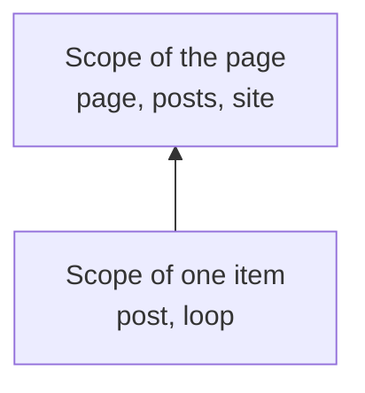

# Rendering

Before a template meets any data, two checks run on the syntax tree. Rendering then walks the tree with the variables of one page.

## Checks before rendering

**Filters.** [`checkFilters`](../../src/template/analysis/check-filters.ts) visits every expression, including those in branches that
might never run, and checks that each filter exists and gets the right number of arguments. A typo in the `else` of a rarely used condition
is found on the first build, not when a page finally needs it.

<!-- reports GS321 -->
```jinja
{{ page.summary | truncate }}
```

```text
line 1, column 48: "truncate" takes 1 to 2 arguments, but got 0
hint: add the missing arguments
```

**How templates use each other.** [`linkTemplates`](../../src/template/analysis/link-templates.ts) is like a linker. It checks that every
included or extended template exists, that none of them uses itself in a circle, and the [rules for layouts](layouts.md). Circles are found
with a depth-first search that keeps its own stack instead of calling itself, so a long chain of templates can't overflow the call stack.
A reference to a template that is still on the stack closes a circle, and the problem names the templates in it.

It also works out a `Layout` for each template: the nodes of the template at the top of its chain of `extends`, and for each block, the
content of the closest template that fills it. Rendering only has to follow that.

## The interpreter

[`Interpreter`](../../src/template/rendering/interpreter.ts) walks the syntax tree and works out each node directly, with no compiled code
in between. For each node it switches on `kind`: text is copied, output is evaluated and printed, a condition evaluates its branches in
order, and a loop renders its body for each item.

### Values

Templates work with the data they are given. Problems describe a value by its kind:

| Kind              | Can be printed | Example in data                                  |
| ----------------- | -------------- | ------------------------------------------------ |
| Text              | Yes            | `"Hello"`                                        |
| A number          | Yes            | `42`                                             |
| True or false     | Yes            | `true`                                           |
| Nothing           | Yes, as empty  | `null`, or a missing field                       |
| A date            | Yes, as written | `{ text: "2026-11-18", year: 2026, month: 11, day: 18 }` |
| A list            | No, use `join` | `["a", "b"]`                                     |
| A group of fields | No, print a field | `{ name: "Ada" }`                             |
| Raw HTML          | Yes, unescaped | What the `raw` filter gives                      |

A date is a group of fields with this shape, which is how frontmatter gives dates to templates.

### One mistake, one problem

When an expression fails, it gives a special value, `FAILED`, instead of a result. Every operator and filter that receives `FAILED` passes it
on without a problem of its own, and a condition or loop that receives it shows nothing. So `missing.title | upper` reports one problem,
the unknown variable, not three.

<!-- reports GS330 -->
```jinja
<h1>{{ pgae.title | upper }}</h1>
```

```json
{ "page": { "title": "Hello" } }
```

```text
line 1, column 8: there is no variable named "pgae"
hint: did you mean "page"?
```

The rest of the template still runs, so one render reports every problem. Inside a loop, a mistake at the same place is reported once,
not once for each item. After rendering, problems are sorted by file and position.

### Scopes

Variables live in a [`Scope`](../../src/template/rendering/scope.ts), which has a parent. Looking up a name tries the scope itself first,
then its parent, and so on:



A loop gives each item a new scope whose parent is the scope around the loop. That is why the loop variable can hide a variable outside,
why it is gone after ``, and why an inner loop has its own `loop`. An included template is rendered in the scope where it is
included. Lookups are recursive, but blocks are nested at most 64 levels deep, so the chain of scopes stays short.

### Missing fields

Reading a missing field gives nothing. When it is printed, that is probably a typo, so it is a warning with a suggestion. In a condition,
in the list of a loop, or before `default`, a missing field is normal, because optional fields are, so it isn't a warning there.

<!-- reports GS331 -->
```jinja
<h1>{{ page.titel }}</h1>
```

```json
{ "page": { "title": "Hello" } }
```

```text
line 1, column 71: "page" has no field "titel"
hint: did you mean "title"?
```

### Escaping

Printed text goes through [`escapeHtml`](../../src/template/rendering/values.ts). The `raw` filter wraps its value in
[`SafeHtml`](../../src/template/rendering/values.ts), which printing leaves alone. Other filters reject `SafeHtml`, because changing HTML
as text could break it, so `raw` has to come last.

### Filters

A filter is a plain function from a value to a new value. When it can't work with the value it gets, it throws
[`FilterError`](../../src/template/rendering/filter-types.ts), and the interpreter turns that into problem [GS334](diagnostics.md) at the
place where the filter was used. Any other error from a custom filter becomes GS334 too, with the error's message, so a broken custom
filter can't stop a build.
